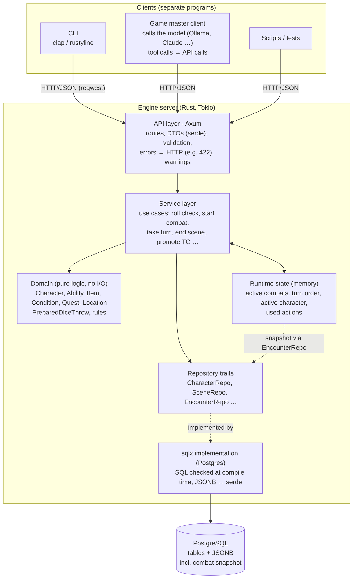

# rpg-engine – Plan

## 1. Ziel & Umfang

| Punkt | Entscheidung |
|---|---|
| Zweck | Generische Solo-Engine; Gates ist nur eine mögliche Kampagne |
| Regeln | Eigenes System, D&D 5e und Gates dienen als Vorlage |
| Modell | Austauschbar (Ollama, Claude, …); Sache des KI-Clients, nicht der Engine |
| Oberfläche | Nur CLI, keine Web-Oberfläche geplant |
| Mechanik durch die Engine | Proben & Kampf · Charakter & Inventar · Welt & NPCs · Quests & Verlauf |
| Funktionen | Hängen am Träger (Gegenstand mit Modi, Charakter mit Rassen-, Klassen- und erlangten Fähigkeiten) |
| Umfang einer Fähigkeit | Benannte Würfelformeln plus feste Folgen (Zustände, Dauer, Ladungen, Nutzungen pro Rast) |
| KI legt Fähigkeiten an | Ja, sie speichert direkt; die Engine meldet Neues, der Spieler kann nachträglich korrigieren |
| Erste Version | Eine Szene läuft komplett durch: Eingabe → Engine → Erzählung → Zustand gespeichert |

### Beispiel Funktionen

```
Gegenstand "Langschwert"
  Modus einhändig:  to_hit = d20 + STR + prof   damage = 1d8 + STR
  Modus zweihändig: to_hit = d20 + STR + prof   damage = 1d10 + STR

Charakter "X"
  Fähigkeiten:
    Dunkelsicht      (Herkunft: Rasse)
    Kampfrausch      (Herkunft: Klasse)
    Schweben         (Herkunft: im Spiel erlangt, von der KI angelegt)
      höhe    = 1d6 ft
      erfolg  = d20 + DEX + prof
```

## 2. Technische Grundentscheidungen

| Punkt | Entscheidung | Folge |
|---|---|---|
| Persistierung | Postgres | Fähigkeiten, Modi und Folgen als JSONB; lokal z. B. per Docker, Start über ein Skript |
| Kampagnen-Trennung | Ein Postgres-Schema pro Kampagne | Kein `campaign_id` in den Tabellen; Schema `public` enthält nur den Katalog (Kampagnenliste, Startpakete wie die D&D-Vorlage); pro Anfrage wird `search_path` gesetzt; Migrationen laufen pro Schema; Backup/Löschen per `pg_dump -n` / `DROP SCHEMA` |
| Schnittstelle | REST-ähnlich, Ressourcen + Befehle | Zustände lesen per GET; Spielhandlungen als Befehle (`POST /sessions/{id}/turns`); die Engine rechnet immer selbst und liefert Ergebnisse (Würfe, Zustände), keine Erzählung |
| CLI-Anbindung | Von Anfang an über die API | Die Engine läuft als lokaler Server, das CLI ist ein echter Client |
| KI-Anbindung | Die KI ist ein normaler API-Client | Der Engine ist egal, ob Skript, KI oder Mensch (CLI) aufruft; sie enthält keinen KI-Code. Ein eigener Spielleiter-Client (oder ein MCP-Server über der API) setzt Tool-Aufrufe des Modells in API-Aufrufe um; Erzählung und Streaming liegen dort |

## 3. Würfelsystem

| Punkt | Entscheidung |
|---|---|
| PreparedDiceThrow (Name vorläufig) | Wird aus einem Formel-String erzeugt (`"2d8 + str"`); beim Erzeugen nur parsen und prüfen |
| Variablen (str, dex, prof, …) | Erst beim Würfeln aufgelöst: `roll(context)` holt die Werte vom aktuellen Charakter |
| Variablen-Bedeutung | `str` in einer Formel = Modifikator (`1d8 + str`); der rohe Wert über `str_value` |
| Ergebnis von `roll()` | Ein Wurf-Objekt: Liste aus gewürfelten Werten und Modifikatoren, kennt `sum()` |
| Referenz | PreparedDiceThrows sind eigene Einträge in der DB; Waffen-Modi und Fähigkeiten verweisen per ID darauf; mehrere Träger können sich einen Wurf teilen |
| KI und Würfe | Die KI darf Würfe nur neu anlegen; Ändern bestehender Würfe ist vorerst nicht vorgesehen |
| Vorteil/Nachteil, Krit | Optionen bei `roll()`, z. B. `roll(context, advantage=True)`; das Wurf-Objekt vermerkt die Option |

```
throw = PreparedDiceThrow("2d8 + str")
roll  = throw.roll(context=character_x)   # z. B. [5, 6, str +3]
roll.sum()                                # 14
```

## 4. Datenmodell

| Punkt | Entscheidung |
|---|---|
| Charakterwerte | Frei definierbar pro Kampagne (Name + Zahl); Standardvorlage: STR, DEX, CON, INT, WIS, CHA, prof, Stufe/EP |
| Wertebindung | Die Engine kennt keine festen Werte; die Kampagne legt ihre Werte fest (z. B. ohne `dex`, mit `luck`). Formeln sprechen Werte per Name an; Being und Figur haben ihre Werte als Many-to-many zu `stat_definition` (`being_stat`, `character_stat`) – die DB erzwingt so, dass nur bekannte Werte existieren |
| Modifikator | Wird nie gespeichert, sondern engine-weit für alle Werte berechnet: `floor((value - 10) / 2)` |
| Being & Klasse | `being` (Wesen: Elf, Mensch, Wolf …) mit Grundwerten (`being_stat`) und Fähigkeiten; gespeichert werden immer nur Werte, Modifikatoren werden daraus berechnet; Spieler/NPC *haben* ein Being als Rasse, ein TC wird *aus* einem Being erzeugt. `character_class` (Krieger …) separat, gibt nur Fähigkeiten (keine Wertänderungen; Steigerungen landen direkt in `character_stat`). Beides gehört zur Kampagne, die KI darf neue anlegen; die D&D-Vorlage ist ein Startpaket zum Übernehmen und Anpassen |
| Gegenstände | Vorlage + Exemplar: Die Vorlage (z. B. „Langschwert“) trägt Modi und Würfe; das Exemplar gehört einem Charakter und hält eigene Daten (Anzahl, Ladungen, Zustand, eigener Name) |
| Exemplar-Erweiterung | Ein Exemplar kann zusätzliche Fähigkeiten und Modi bekommen (z. B. Verzauberung `+1d6 Feuer`); die Vorlage bleibt unverändert |
| Aktive Zustände | Eigene Einträge am Charakter: Name, Quelle (Fähigkeit/Gegenstand/Gegner), Dauer (Runden/Rast/dauerhaft), Wirkung (Wertänderungen, Vorteil/Nachteil); die Engine zählt herunter und entfernt Abgelaufenes |
| Figuren | Ein gemeinsames Modell (Werte, Fähigkeiten, Gegenstände, Zustände) mit Typ: **Spieler**, **NPC** (benannt, taucht mehrfach auf), **TC** (temporärer Charakter, z. B. ein Wolf aus einer Zufallsbegegnung). Ein TC kann zum NPC befördert werden |
| Kreaturen | Kreaturen sind Beings; aus ihnen werden TCs erzeugt |
| Kennungen | NPC: Name, eindeutig in der ganzen Kampagne. TC: kein Name, nur eine Kennung (z. B. `wolf_01`), eindeutig pro Begegnung |
| TC-Lebensdauer | Ein TC wird nach der Begegnung gelöscht, außer er wurde zum NPC befördert |
| Szenen-Protokoll | Die Szene speichert, wie viele von welchem Being vorkamen und was mit ihnen geschah |
| TC-Ausgang | Feste Ausgänge (getötet, geflohen, verschont, gezähmt, befördert) plus optionale Notiz; auswertbar (z. B. „12 Wölfe getötet“) |
| Orte | Baumstruktur (z. B. Kontinent → Stadt → Taverne) mit Beschreibung und Notizen; NPCs und Gegenstände können einem Ort zugeordnet sein; die KI darf neue Orte anlegen |
| Quests | Baumstruktur: Teilziele sind selbst Quests (gleicher Typ). Jede hat Titel, Beschreibung, Status (offen/aktiv/erledigt/gescheitert), zwingend einen Auftraggeber (beliebige Figur, auch der Spieler selbst), optional Verknüpfungen zu Orten und Belohnungen; die KI darf Quests anlegen und den Status ändern |
| Quest-Status | Wird manuell bzw. von der KI gesetzt, nicht automatisch aus Teilzielen abgeleitet; die Engine meldet nur Hinweise (z. B. „Alle Teilziele erledigt“) – so bleiben optionale Teilziele und alternative Wege möglich |
| Verlauf | Kampagne → Szene; dauerhaft gespeichert werden pro Szene nur Zusammenfassung und Szenen-Protokoll |
| Züge | Die Engine verwaltet Züge im Speicher, persistiert sie aber nicht |
| Kampfstart | Die KI startet einen Kampf per Tool mit einer Liste aus Figuren (ID/Name) und ihrer Initiative; die Engine führt daraus die Reihenfolge |
| Aktionsökonomie | Die Engine merkt sich pro Figur und Runde, was genutzt wurde (Bewegung, Aktion, Bonusaktion, Reaktion …) |
| Kampf-Schnappschuss | Laufender Kampf (Reihenfolge, aktive Figur, genutzte Aktionen) wird als temporärer Schnappschuss gespeichert, nach Kampfende gelöscht; erlaubt Fortsetzen nach Server-Neustart |
| Szenenende | Die KI beendet eine Szene per API-Aufruf, wenn die Erzählung es nahelegt (Ortswechsel, Zeitsprung …); der Spieler sagt es der KI oder ruft selbst auf. Die Zusammenfassung ist Pflichtparameter: fehlt sie, lehnt die Engine ab (z. B. 422 mit Hinweis); ein leerer String wird akzeptiert, die Antwort enthält aber eine Warnung „Zusammenfassung leer“ |

## 5. Sprache & Werkzeuge

| Punkt | Entscheidung | Begründung |
|---|---|---|
| Sprache | Rust | Prioritäten: Typzwang, klare Strukturen, Clean-Code-Zwang, Performance/Speicher, wenig Overhead. Komposition + Traits + Enums statt Vererbung passen zum Datenmodell (Figur mit Typ, Vorlage + Exemplar) |
| DB-Anbindung | sqlx (Postgres) | SQL selbst geschrieben, beim Kompilieren gegen das Schema geprüft; JSONB per serde; Migrationen eingebaut |
| DB-Abstraktion | Repository-Traits (z. B. `CharacterRepo`, `SceneRepo`) | Die Engine kennt nur die Traits; zuerst Postgres-Umsetzung, weitere DBs (SQLite, MongoDB …) später ohne Engine-Änderung |
| API-Framework | Axum (auf Tokio) | Verbreitet, schlank, typsichere Extraktoren, passt zu sqlx und serde |
| Code-Sprache | Englisch | Gesamte Engine englisch: Code, DB-Schema, API, Tool-Namen. Der Plan bleibt deutsch; Begriffe siehe Glossar |

## 6. Architektur

Quelle: `docs/architektur.mmd`



Abhängigkeiten zeigen nur nach unten: Die Domäne kennt weder Axum noch sqlx; die Service-Schicht kennt nur die Repository-Traits.

## 7. ERD

Quelle: `docs/erd.mmd`

```mermaid
erDiagram

    ABILITY ||--o{ ABILITY_THROW : "named formulas"
    DICE_THROW ||--o{ ABILITY_THROW : "used by"
    DICE_THROW ||--o{ MODE_THROW : "used by"

    BEING ||--o{ BEING_STAT : "base stats"
    STAT_DEFINITION ||--o{ BEING_STAT : "of"
    CHARACTER ||--o{ CHARACTER_STAT : "stats"
    STAT_DEFINITION ||--o{ CHARACTER_STAT : "of"
    BEING ||--o{ BEING_ABILITY : "grants"
    ABILITY ||--o{ BEING_ABILITY : "in"
    CHARACTER_CLASS ||--o{ CLASS_ABILITY : "grants"
    ABILITY ||--o{ CLASS_ABILITY : "in"

    BEING ||--o{ CHARACTER : "is a (race / creature)"
    CHARACTER ||--o{ CHARACTER_CLASS_LINK : "has class"
    CHARACTER_CLASS ||--o{ CHARACTER_CLASS_LINK : "of"
    CHARACTER ||--o{ CHARACTER_ABILITY : "has"
    ABILITY ||--o{ CHARACTER_ABILITY : "in"
    CHARACTER ||--o{ CONDITION : "active"
    LOCATION |o--o{ CHARACTER : "is at"

    ITEM_TEMPLATE ||--o{ MODE : "default modes"
    ITEM_TEMPLATE ||--o{ ITEM_INSTANCE : "instances"
    ITEM_INSTANCE |o--o{ MODE : "extra modes"
    MODE ||--o{ MODE_THROW : "formulas"
    ITEM_INSTANCE ||--o{ ITEM_INSTANCE_ABILITY : "extra"
    ABILITY ||--o{ ITEM_INSTANCE_ABILITY : "in"
    CHARACTER |o--o{ ITEM_INSTANCE : "owns"
    LOCATION |o--o{ ITEM_INSTANCE : "lies at"

    LOCATION |o--o{ LOCATION : "contains"
    QUEST |o--o{ QUEST : "sub-quests"
    CHARACTER ||--o{ QUEST : "quest giver (required)"
    QUEST ||--o{ QUEST_LOCATION : ""
    LOCATION ||--o{ QUEST_LOCATION : ""

    LOCATION |o--o{ SCENE : "takes place at"
    SCENE ||--o{ ENCOUNTER : "has"
    ENCOUNTER |o--o{ CHARACTER : "TCs"
    SCENE ||--o{ SCENE_BEING_LOG : "beings met"
    BEING ||--o{ SCENE_BEING_LOG : "being"

    CAMPAIGN {
        uuid id PK "schema public (catalog)"
        text name
        text schema_name "one schema per campaign"
    }
    STAT_DEFINITION {
        uuid id PK
        text name "e.g. str, luck, hp; unique"
        text description
    }
    DICE_THROW {
        uuid id PK
        text formula "e.g. 2d8 + str"
    }
    ABILITY {
        uuid id PK
        text name
        text description
        jsonb effects "conditions, duration, charges, uses per rest"
    }
    ABILITY_THROW {
        uuid ability_id PK,FK
        text name PK "e.g. success, height"
        uuid dice_throw_id FK
    }
    BEING {
        uuid id PK
        text name "e.g. elf, human, wolf"
    }
    BEING_STAT {
        uuid being_id PK,FK
        uuid stat_id PK,FK
        int value "modifier is derived"
    }
    CHARACTER_STAT {
        uuid character_id PK,FK
        uuid stat_id PK,FK
        int value "modifier is derived"
    }
    BEING_ABILITY {
        uuid being_id PK,FK
        uuid ability_id PK,FK
    }
    CHARACTER_CLASS {
        uuid id PK
        text name "e.g. fighter"
    }
    CLASS_ABILITY {
        uuid class_id PK,FK
        uuid ability_id PK,FK
    }
    CHARACTER {
        uuid id PK
        text kind "player | npc | tc"
        text name "NPC: unique"
        text handle "TC: e.g. wolf_01, unique per encounter"
        uuid being_id FK "race (player/NPC) or creature (TC)"
        uuid encounter_id FK "TC only"
        uuid location_id FK
    }
    CHARACTER_CLASS_LINK {
        uuid character_id PK,FK
        uuid class_id PK,FK
    }
    CHARACTER_ABILITY {
        uuid character_id PK,FK
        uuid ability_id PK,FK
        text origin "being | class | acquired"
        int uses_left
    }
    CONDITION {
        uuid id PK
        uuid character_id FK
        text name
        text source_kind "ability | item | character"
        uuid source_id
        text duration_kind "rounds | rest | permanent"
        int duration_left
        jsonb effect "stat modifiers, advantage/disadvantage"
    }
    ITEM_TEMPLATE {
        uuid id PK
        text name
        text description
    }
    ITEM_INSTANCE {
        uuid id PK
        uuid template_id FK
        uuid owner_id FK "character, optional"
        uuid location_id FK "optional"
        text custom_name
        int quantity
        int charges
        text item_condition
    }
    MODE {
        uuid id PK
        uuid item_template_id FK "either"
        uuid item_instance_id FK "or"
        text name "e.g. two_handed"
    }
    MODE_THROW {
        uuid mode_id PK,FK
        text name PK "to_hit, damage"
        uuid dice_throw_id FK
    }
    ITEM_INSTANCE_ABILITY {
        uuid item_instance_id PK,FK
        uuid ability_id PK,FK
    }
    LOCATION {
        uuid id PK
        uuid parent_id FK
        text name
        text description
        text notes
    }
    QUEST {
        uuid id PK
        uuid parent_id FK
        text title
        text description
        text status "open | active | done | failed"
        uuid quest_giver_id FK "required"
        jsonb reward
    }
    QUEST_LOCATION {
        uuid quest_id PK,FK
        uuid location_id PK,FK
    }
    SCENE {
        uuid id PK
        int number
        uuid location_id FK
        text summary "required on end"
        timestamptz ended_at
    }
    ENCOUNTER {
        uuid id PK
        uuid scene_id FK
        bool active
        jsonb combat_snapshot "turn order, active character, used actions; null after end"
    }
    SCENE_BEING_LOG {
        uuid scene_id PK,FK
        uuid being_id PK,FK
        text outcome PK "killed | fled | spared | tamed | promoted"
        int count
        text note
    }
```



Alle Tabellen außer `campaign` liegen im Schema der jeweiligen Kampagne; `campaign` liegt im Schema `public`.

Annahmen (noch zu bestätigen):
- `encounter` ist eigene Tabelle: Rahmen für TC-Kennungen (`unique(encounter_id, handle)`) und Kampf-Schnappschuss. TCs werden mit der Begegnung gelöscht, außer befördert.
- NPC-Name eindeutig per partiellem Unique-Index (`unique(name) where kind = 'npc'`).

## Glossar (Plan → Code)

| Deutsch | Englisch |
|---|---|
| Kampagne | Campaign |
| Wert / Wertdefinition | Stat / StatDefinition |
| Wurf (vorbereitet) | DiceThrow / PreparedDiceThrow |
| Fähigkeit | Ability |
| Folgen | Effects |
| Wesen (Rasse, Kreatur) / Klasse | Being / CharacterClass |
| Figur | Character |
| Spieler / NPC / TC | player / npc / tc (temporary character) |
| Kennung (TC) | handle |
| Gegenstand-Vorlage / Exemplar | ItemTemplate / ItemInstance |
| Modus | Mode |
| Zustand (aktiv) | Condition |
| Ort | Location |
| Quest / Teilziel | Quest / sub-quest |
| Szene / Zusammenfassung | Scene / summary |
| Begegnung | Encounter |
| Szenen-Protokoll / Ausgang | SceneBeingLog / outcome |
| Kampf-Schnappschuss | combat_snapshot |
